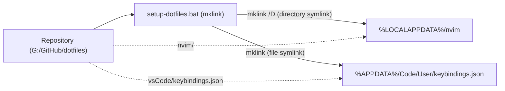

# Dotfiles


Personal Windows developer environment featuring a single-file, IDE-grade **Neovim** setup (Lua + `lazy.nvim`) and matching Space-leader **VS Code** Vim keybindings, deployed automatically via Windows symlinks.

---

## Highlights

- **Unified Space-Leader Workflow**: Consistent `<Space>` leader keybindings, `<C-h/j/k/l>` window navigation, and Vim-first muscle memory shared across both Neovim and VS Code.
- **Full-Featured Neovim IDE (`nvim/init.lua`)**:
  - **Rust & Multi-Language Support**: Dedicated `rustaceanvim` (`^9`), automatic LSP provisioning via `mason.nvim` + `mason-lspconfig.nvim`, `nvim-cmp` + `LuaSnip` completion, and `nvim-treesitter` syntax highlighting.
  - **Integrated Debugging (DAP)**: Preconfigured `nvim-dap` + `nvim-dap-ui` + `mason-nvim-dap` for **Python (`debugpy`)**, **C/C++/Rust (`codelldb`)**, **C#/.NET (`coreclr`)**, and **JavaScript/TypeScript (`js-debug-adapter`)** with Windows/Unix `debugpy` path auto-detection.
  - **Format on Save & Autosave**: `conform.nvim` (`stylua`, `prettier`, `isort`, `black` with LSP fallback) plus automatic buffer saving on `FocusLost` and `BufLeave`.
  - **Modern UI & Ergonomics**: `cyberdream.nvim` colorscheme with a live transparency toggle (`<leader>bg`), 7-color rainbow `indent-blankline.nvim`, `lualine.nvim`, `smear-cursor.nvim`, and `snacks.nvim` (dashboard, notifications, scratchpad, and integrated Lazygit).
  - **Fast Fuzzy Finding & File Ops**: `telescope.nvim` backed by `ripgrep` (including an Alt-Tab-style MRU buffer switcher on `<leader><space>`) and `mini.files` with single-step open-and-close navigation.
- **One-Command Windows Deployment**: `setup-dotfiles.bat` links the repository directly into `%LOCALAPPDATA%\nvim` and `%APPDATA%\Code\User\keybindings.json`.

---

## Symlink Deployment Architecture



---

## Project Structure

```text
dotfiles/
├── setup-dotfiles.bat          # Windows batch script to create Neovim & VS Code symlinks
├── nvim/
│   ├── init.lua                # Complete Neovim configuration (options, lazy.nvim plugins, keymaps)
│   └── lazy-lock.json          # Pinned plugin revisions managed by lazy.nvim
└── vsCode/
    └── keybindings.json        # Space-leader & explorer keybindings tailored for VSCodeVim
```

---

## Getting Started

### Prerequisites

- **Windows 10 / 11** with **Administrator privileges** (or **Windows Developer Mode** enabled, required by `mklink`).
- **[Neovim](https://neovim.io/)** (0.10+ recommended) and **[Git](https://git-scm.com/)** (used by `lazy.nvim` to bootstrap plugins).
- **[ripgrep (`rg`)](https://github.com/BurntSushi/ripgrep)** — required for Telescope `find_files` and `live_grep`.
- **A [Nerd Font](https://www.nerdfonts.com/)** (with legacy computing symbols support recommended for `smear-cursor.nvim` and `nvim-web-devicons`).
- **Optional CLI tools**: `lazygit` (for `<leader>gg`), C compiler/toolchain for Treesitter parsers, and formatters (`stylua`, `prettier`, `isort`, `black`) or Mason installations.
- **[VS Code](https://code.visualstudio.com/)** with the **[VSCodeVim](https://marketplace.visualstudio.com/items?itemName=vscodevim.vim)** extension (keybindings rely on `vim.mode` contexts).

### Installation

1. **Clone the repository**:
   ```powershell
   git clone https://github.com/Dudek03/dotfiles.git G:\GitHub\dotfiles
   ```
2. **Adjust the repository path (if cloned elsewhere)**:
   Open `setup-dotfiles.bat` and update line 7 if your clone path differs from the default:
   ```bat
   set "DOTFILES=G:\GitHub\dotfiles"
   ```
3. **Back up any existing configs**:
   > [!WARNING]
   > `setup-dotfiles.bat` **deletes** existing `%LOCALAPPDATA%\nvim` (`rmdir /s /q`) and `%APPDATA%\Code\User\keybindings.json` (`del`) before creating the symlinks. Back them up first if you want to keep your previous setup.
4. **Run the installer as Administrator**:
   Right-click `setup-dotfiles.bat` and select **Run as administrator**, or run from an elevated Command Prompt / PowerShell:
   ```powershell
   .\setup-dotfiles.bat
   ```
5. **Launch Neovim**:
   Run `nvim`. On first launch, `lazy.nvim` will automatically clone itself, install all plugins pinned in `lazy-lock.json`, and let Mason install configured DAP adapters.

---

## Neovim Configuration (`nvim/init.lua`)

### Core Editor Settings

- **Leader**: `<Space>` (`mapleader` and `maplocalleader`)
- **Line Numbers**: Relative + absolute (`number`, `relativenumber`) with `signcolumn = "yes"` and `scrolloff = 4`
- **Indentation**: 4 spaces (`tabstop = 4`, `softtabstop = 4`, `shiftwidth = 4`, `expandtab = true`)
- **Clipboard & History**: System clipboard integration (`clipboard = "unnamedplus"`) and persistent undo (`undofile = true`)
- **Autosave**: Automatically executes `silent! update` on `FocusLost` and `BufLeave`

### Plugin Stack

| Category | Plugins | Highlights |
| :--- | :--- | :--- |
| **Plugin Manager** | `folke/lazy.nvim` | Self-bootstrapping with lockfile (`lazy-lock.json`) |
| **Theme & UI** | `cyberdream.nvim`, `lualine.nvim`, `nvim-web-devicons`, `indent-blankline.nvim`, `smear-cursor.nvim` | Cyberdream theme + transparency toggle, 7-color rainbow indents, animated cursor |
| **Workflow & Utilities** | `folke/snacks.nvim`, `folke/which-key.nvim`, `echasnovski/mini.nvim` | Dashboard, notifier, bigfile, quickfile, Lazygit, scratchpad, `mini.pairs`, `mini.surround`, `mini.files` |
| **Fuzzy Finding** | `nvim-telescope/telescope.nvim` (`0.1.x`), `plenary.nvim` | `ripgrep`-powered hidden file search, ignores `.git`, `node_modules`, `.venv`, `build/`, `dist/` |
| **LSP & Completion** | `nvim-lspconfig`, `mason.nvim`, `mason-lspconfig.nvim`, `nvim-cmp`, `cmp-nvim-lsp`, `LuaSnip` | Auto-configured LSP servers + `<C-j/k/l>` & `<C-n/p/y>` completion navigation |
| **Rust** | `mrcjkb/rustaceanvim` (`^9`) | Dedicated Rust analyzer & tooling integration |
| **Syntax & Formatting** | `nvim-treesitter`, `stevearc/conform.nvim` | Auto-installed parsers (`lua`, `vim`, `vimdoc`, `js`, `ts`, `python`); format on save (`stylua`, `prettier`, `isort`, `black`) |
| **Debugging (DAP)** | `nvim-dap`, `nvim-dap-ui`, `nvim-nio`, `mason-nvim-dap.nvim`, `nvim-dap-python` | Auto-installed `debugpy`, `codelldb`, `coreclr`, `js-debug-adapter`; auto-toggle DAP UI |
| **Git & Extras** | `gitsigns.nvim`, `vim-wakatime`, `carbon-now.nvim` | Inline git hunks, WakaTime coding telemetry, `:CarbonNow` code snippets |

### Keybindings Reference

#### General, Movement & Splits

| Mode | Keybinding | Action |
| :--- | :--- | :--- |
| `i` | `jj` / `jk` / `kj` | Exit Insert mode (`<Esc>`) |
| `n` | `<C-q>` | Enter Visual Block mode (`<C-v>` — avoids Windows paste conflict) |
| `n` | `<C-s>` | Save current file |
| `n` | `<Esc>` | Clear search highlight (`:noh`) |
| `n` | `<C-d>` / `<C-u>` / `n` / `N` | Half-page scroll / next-prev search (keeps cursor centered) |
| `v` | `<` / `>` | Indent left / right while staying in Visual mode |
| `n` | `<leader>v` / `<leader>h` | Split vertically / horizontally |
| `n` | `<leader>se` / `<leader>xs` | Equalize splits / close active window |
| `n` | `<C-h>` / `<C-j>` / `<C-k>` / `<C-l>` | Move focus between splits |
| `n` | `<Tab>` / `<S-Tab>` | Next / previous buffer |
| `n` | `<leader>bd` | Delete buffer (`Snacks.bufdelete`) |
| `n` | `<leader>bg` | Toggle transparent background / restore `cyberdream` |

#### Telescope, Files & Tools

| Mode | Keybinding | Action |
| :--- | :--- | :--- |
| `n` | `<leader><space>` | **Telescope MRU Buffers ("Alt-Tab")** — switches between recent buffers excluding the current one |
| `n` | `<leader>sf` | Find files (`rg --files --hidden`) |
| `n` | `<leader>sg` | Live grep across workspace |
| `n` | `<leader>sk` / `<leader>sd` | Search keymaps / workspace diagnostics |
| `i` / `n` (Telescope) | `<C-j>` / `<C-k>` / `<C-l>` | Next item / previous item / select item (`dd` deletes buffer in Normal mode) |
| `n` | `<leader>e` | Open `mini.files` explorer (`<CR>` or `l` opens file and closes explorer) |
| `n` | `<leader>gg` | Open Lazygit (`Snacks.lazygit`) |
| `n` | `<leader>.` | Toggle floating Scratchpad (`Snacks.scratch`) |

#### LSP, Diagnostics & Debugging

| Mode | Keybinding | Action |
| :--- | :--- | :--- |
| `n` | `<leader>gd` | Go to definition |
| `n` | `<leader>d` | Open floating diagnostic error message |
| `n` | `[d` / `]d` | Jump to previous / next diagnostic |
| `n` | `<leader>do` | Toggle diagnostics on/off |
| `n` | `<F5>` | Start / Continue debugging |
| `n` | `<F10>` / `<F11>` | Step Over / Step Into |
| `n` | `<leader>db` / `<leader>dx` | Toggle breakpoint / Terminate debug session |

---

## VS Code Keybindings (`vsCode/keybindings.json`)

Designed to pair with **VSCodeVim**, providing matching Space-leader navigation, coding, debugging, and Vim-style File Explorer shortcuts:

| Context | Keybinding | Action |
| :--- | :--- | :--- |
| **Global** | `Ctrl+h` / `Ctrl+j` / `Ctrl+k` / `Ctrl+l` | Navigate left / down / up / right across editor groups & panels |
| **Normal** | `Space Space` / `Space ,` | Quick Open files / Show all open editors |
| **Normal** | `Space e` | Smart toggle sidebar & focus File Explorer (or return focus to editor) |
| **Normal** | `s h` / `s v` | Split editor right / split editor down |
| **Normal** | `Space b d` / `Space b o` | Close active editor / close other editors |
| **Normal** | `Space c a` / `Space c r` / `Space c s` | Code Actions / Rename symbol / Go to Symbol |
| **Normal** | `Space g d` / `Space g r` / `Space g i` | Go to Definition / References / Implementation |
| **Normal** | `Space s g` / `Space g g` | Find in Files / Open & focus Source Control |
| **Normal / VisualLine** | `Shift+K` / `Shift+J` | Hover docs (Normal); move selected lines up/down (VisualLine) |
| **Normal / Visual** | `Ctrl+n` | Add selection to next find match |
| **File Explorer** | `a`, `r`, `c`, `x`, `p`, `d`, `s`, `Shift+S`, `Enter` | New file, rename, copy, cut, paste, delete, open to side, open in split down, open/expand |
| **Debug (Normal)** | `Space d a` / `Space d b` / `Space d c` / `Space d o` / `Space d e` / `Space d t` | Select & start / toggle breakpoint / continue / step over / debug hover / stop |
